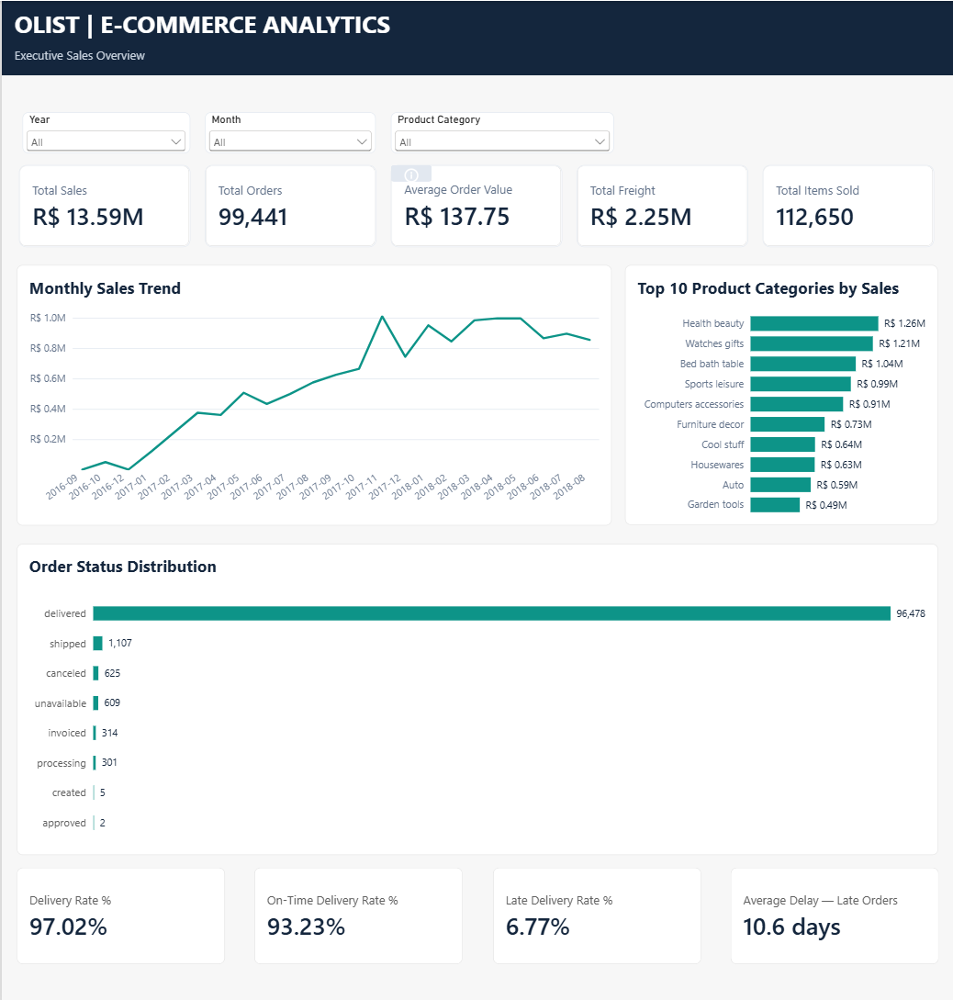
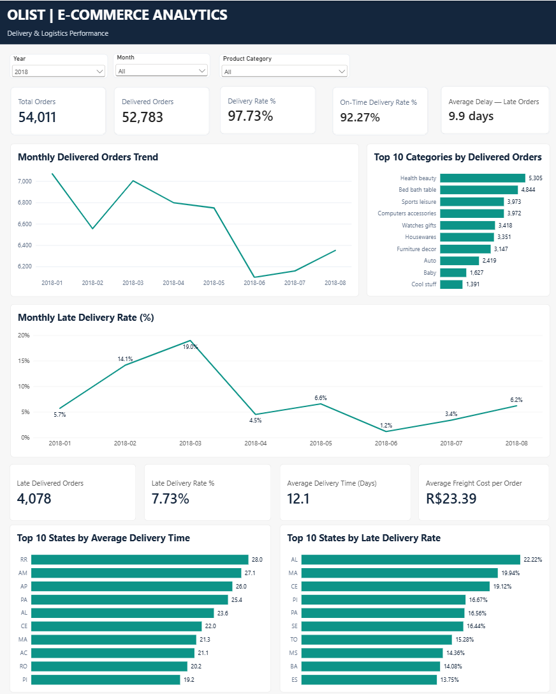
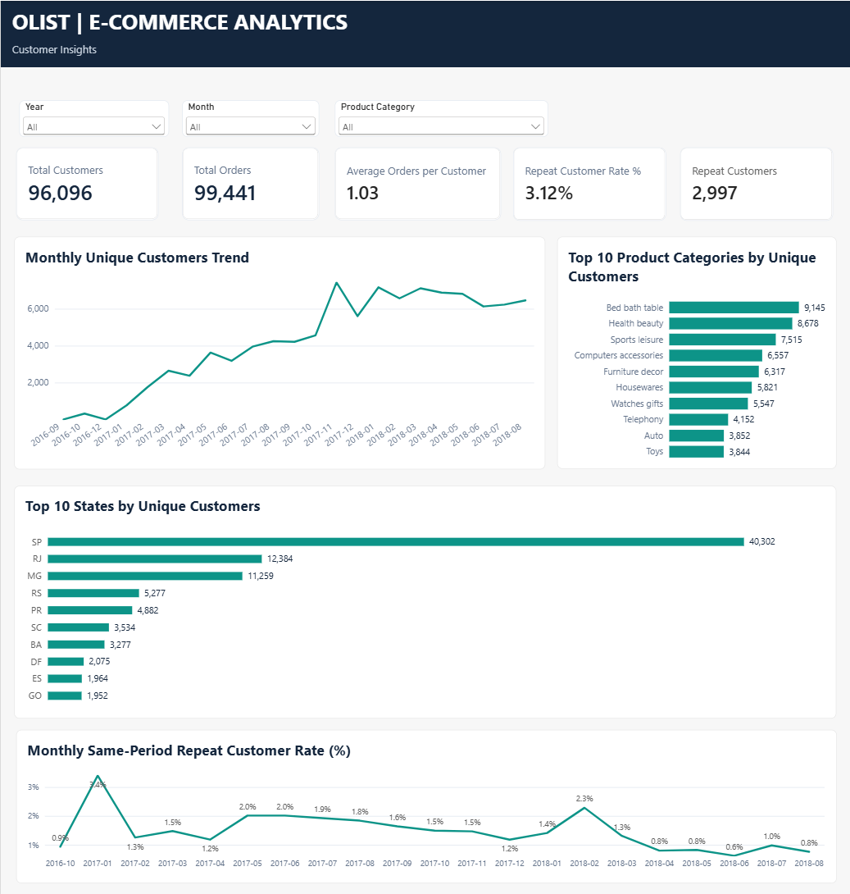
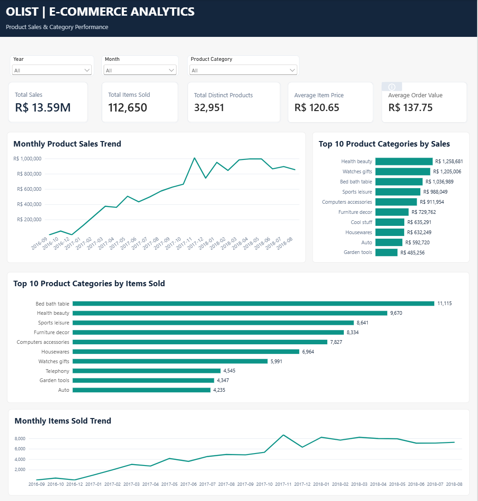

# E-Commerce Sales Analysis | Power BI Portfolio Project

## Project Overview

An end-to-end e-commerce data analytics project using the Brazilian Olist E-Commerce Dataset to explore sales performance, customer purchasing behavior, product trends, and delivery operations.

The project demonstrates the application of data analysis, business intelligence, and data visualization techniques to transform transactional data into actionable business insights.

### Project Objectives

- Analyze overall sales performance and revenue trends.
- Evaluate delivery efficiency and identify logistics improvement opportunities.
- Understand customer purchasing behavior and repeat purchase patterns.
- Identify top-performing product categories and revenue contributors.
- Develop data-driven business recommendations supported by measurable performance indicators.

### Tools and Technologies

- **Power BI:** Interactive dashboards and data visualization.
- **Power Query:** Data preparation and transformation.
- **DAX:** Custom business measures and KPI calculations.
- **GitHub:** Project documentation and version control.

### Dashboard Pages

1. Executive Sales Overview
2. Delivery & Logistics Performance
4. Customer Insights
5. Product Performance
6. Business Insights & Recommendations

## Dashboard Preview

### 1. Executive Sales Overview

### 2. Delivery & Logistics Performance

### 3. Customer Insights

### 4. Product Performance

## Key Performance Indicators (KPIs)

The dashboard analyzes the Brazilian Olist E-Commerce Dataset and provides the following overall performance metrics.

| KPI | Result |
|---|---|
| Total Sales Revenue | R$13.59M |
| Total Orders | 99,441 |
| Total Items Sold | 112,650 |
| Average Order Value | R$137.75 |
| Unique Customers | 96,096 |
| Repeat Customers | 2,997 |
| Repeat Customer Rate | 3.12% |
| Delivered Orders | 96,478 |
| Delivery Rate | 97.02% |
| On-Time Delivery Rate | 93.23% |
| Late Delivered Orders | 6,534 |
| Late Delivery Rate | 6.77% |
| Average Delivery Time | 12.5 days |
| Distinct Products Sold | 32,951 |

### KPI Calculation Notes

- **Total Sales Revenue:** Sum of merchandise prices, excluding freight charges.
- **Average Order Value:** Merchandise revenue divided by the number of orders containing recorded items.
- **Repeat Customer Rate:** Percentage of unique customers who placed more than one order within the selected reporting period.
- **On-Time Delivery Rate:** Percentage of eligible delivered orders received on or before their estimated delivery date.
- **Late Delivery Rate:** Percentage of eligible delivered orders received after their estimated delivery date.

These results represent the full dataset without additional year, month, or product-category filters.

## Key Business Findings and Recommendations

### 1. Revenue Growth Opportunity

**Key Findings**
- Health & Beauty generated approximately **R$1.26M**, contributing **9.26%** of total merchandise revenue.
- Bed, Bath & Table recorded the highest sales volume, with **11,115 items sold**.
- Different product categories lead in revenue and sales volume, highlighting opportunities for category-level analysis.

**Business Recommendations**
- Evaluate pricing and product assortment within high-performing categories.
- Investigate cross-selling opportunities between complementary products.
- Monitor average order value and category revenue contribution to measure improvements.

### 2. Delivery and Logistics Performance

**Key Findings**
- The overall on-time delivery rate was **93.23%** among eligible delivered orders.
- **6,534 delivered orders** arrived late, representing a **6.77% late delivery rate**.
- Alabama (AL) recorded a particularly high late delivery rate of **21.41%**.

**Business Recommendations**
- Investigate shipping delays in states with elevated late delivery rates.
- Evaluate carrier performance, shipping routes, and fulfillment processes.
- Prioritize operational improvements based on both delay frequency and affected order volume.

**Success Metric:** On-Time Delivery Rate (%).

### 3. Customer Retention Opportunity

**Key Findings**
- The dataset contains **96,096 unique customers**.
- Only **2,997 customers** placed multiple orders during the reporting period.
- The overall repeat customer rate was **3.12%**.

**Business Recommendations**
- Explore customer purchasing patterns and opportunities to encourage repeat purchases.
- Test targeted promotions, loyalty initiatives, and post-purchase engagement.
- Evaluate campaign effectiveness through controlled experiments.

**Success Metric:** Repeat Customer Rate (%).

### 4. Prioritized Business Action Plan

| Priority | Recommended Action | Success Metric |
|---|---|---|
| High | Reduce delivery delays in high-risk states | On-Time Delivery Rate (%) |
| High | Test repeat-purchase campaigns | Repeat Customer Rate (%) |
| Medium | Optimize category pricing and product mix | Average Order Value |

**Note:** These recommendations are proposed actions based on descriptive analysis. Their effectiveness should be evaluated through additional investigation, experimentation, and ongoing KPI monitoring.
