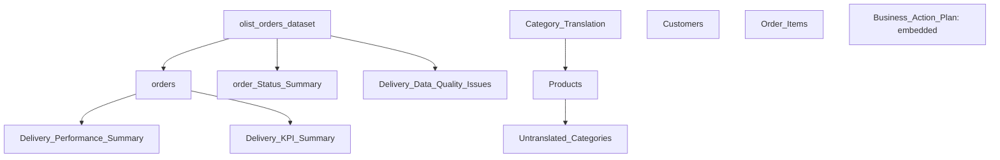

# Power Query and Data Model Documentation

## Project overview

This document describes the Power Query (M) transformations and visible Power BI model relationships used in the **Olist E-Commerce Analytics** portfolio dashboard. The dashboard includes executive sales, delivery and logistics, customer insights, product performance, and business recommendations.

**Data source:** Olist e-commerce CSV datasets. **Transformation engine:** Power Query in Power BI Desktop. **Analysis:** DAX measures and report visuals.

> **Portability note:** Source queries currently use absolute Windows `File.Contents(...)` paths. Update them to your own local dataset folder before refreshing the PBIX. Personal and organizational paths have intentionally been omitted from this public documentation. For example: `File.Contents("C:\\path\\to\\Data\\olist_orders_dataset.csv")`.

## Query inventory

| Query | Source / dependency | Purpose and implemented steps |
|---|---|---|
| `olist_orders_dataset` | `olist_orders_dataset.csv` | Import 8 CSV fields; promote headers; type IDs/status as text and five order timestamps as datetime. |
| `Customers` | `olist_customers_dataset.csv` | Import 5 fields; promote headers; type all columns as text, including ZIP prefix and customer identifiers. |
| `Order_Items` | `olist_order_items_dataset.csv` | Import 7 fields; promote headers; type IDs as text, item number as integer, shipping limit as datetime, price and freight as numbers. |
| `Category_Translation` | `product_category_name_translation.csv` | Import UTF-8 two-column lookup; promote headers; type Portuguese and English category names as text. |
| `Products` | `olist_products_dataset.csv`, `Category_Translation` | Import 9 product fields; promote headers; set types; create cleaned category; left join translation lookup; expand English label; create final category with defined fallbacks. |
| `orders` | `olist_orders_dataset` | Add delivery delay days, descriptive delivery status, and KPI-eligibility-aware delivery status; set types. |
| `Untranslated_Categories` | `Products` | Find products whose raw English translation is missing, group by original category, count products, sort descending. |
| `order_Status_Summary` | `olist_orders_dataset` | Count rows per order status; calculate each share using a hardcoded 99,441-order denominator; format as percentage. |
| `Delivery_Performance_Summary` | `orders` | Count rows per descriptive delivery performance status. |
| `Delivery_KPI_Summary` | `orders` | Count rows per KPI eligibility/delivery status. |
| `Delivery_Data_Quality_Issues` | `olist_orders_dataset` | Flag non-delivered-status rows that nevertheless have a non-null customer delivery date. |
| `Business_Action_Plan` | Embedded static table | Deserialize/decompress entered rows; type Priority, Recommended Action, and Success Metric as text. |

## Key transformation rules

### Order delivery classifications (`orders`)

`Delivery_Delay_Days` uses calendar dates rather than elapsed 24-hour intervals:

```powerquery
if [order_delivered_customer_date] = null
    or [order_estimated_delivery_date] = null
then null
else Duration.Days(
    Date.From([order_delivered_customer_date])
    - Date.From([order_estimated_delivery_date])
)
```

A negative value means early, zero means on the estimated date, and a positive value means late. Missing delivery or estimated dates yield `null`.

- `Delivery_Performance_Status`: `Not Delivered / Missing Date` if delay is null; otherwise `On Time / Early` for delay <= 0, or `Late` for delay > 0. This field **does not separately check `order_status`**.
- `Delivery_KPI_Status`: `Excluded - Not Delivered Status` when `order_status <> "delivered"`; otherwise `Excluded - Missing Delivery Date` when delay is null; otherwise `On Time / Early` or `Late`. This distinction supports more defensible delivery KPIs.
- `Delivery_Performance_Summary` and `Delivery_KPI_Summary` are precomputed row-count tables. Unlike DAX measures, they do not automatically recompute their group counts for report slicer selections.

### Product category normalization (`Products`)

- `Product_Category_Clean`: uses `Unknown` for null/blank original category values, otherwise trims surrounding whitespace.
- Left-joins `Category_Translation` on `product_category_name` and expands `product_category_name_english`.
- `Category_English_Final`: uses a nonblank translated English category when available; otherwise explicitly maps `pc_gamer` to `pc_gamer` and `portateis_cozinha_e_preparadores_de_alimentos` to `portable_kitchen_food_preparers`; all other missing translations become `Unknown`.
- `Untranslated_Categories` checks the **raw expanded translation**, not `Category_English_Final`; consequently, it can still list categories that have an explicit final-label fallback.

### Order status distribution (`order_Status_Summary`)

The query groups by `order_status`, counts rows in `Order_Count`, and calculates:

```powerquery
[Order_Count] / 99441
```

**Limitation:** The denominator is hardcoded to the current dataset size. If the dataset changes, these percentages may be wrong. A dynamic alternative, **not currently implemented**, is:

```powerquery
[Order_Count] / List.Sum(#"Grouped Rows"[Order_Count])
```

### Customer identifier handling (`Customers`)

`customer_id` and `customer_unique_id` remain distinct text fields. The latter is needed to identify repeat buyers across orders. `customer_zip_code_prefix` is text to preserve possible leading zeros. The provided query does not explicitly deduplicate customers, standardize city names, or fill missing fields.

### Business action plan

`Business_Action_Plan` is a manually entered/embedded table with `Priority`, `Recommended Action`, and `Success Metric`. It is not a dynamically generated recommendation engine, and its values do not automatically change with report filters.

## Data-quality checks

| Check | Implementation | Interpretation / boundary |
|---|---|---|
| Missing category translations | `Untranslated_Categories`: filter null English translation and nonblank original category; group and count | Highlights lookup coverage gaps; does not check every possible category-quality problem. |
| Delivery status/date contradiction | `Delivery_Data_Quality_Issues`: `order_status <> "delivered"` and `order_delivered_customer_date <> null` | Flags possible inconsistencies; does not constitute a complete audit of all delivery timestamps or statuses. |
| Missing delivery dates | `Delivery_KPI_Status` | Excludes delivered orders whose delay cannot be computed. |
| Non-delivered orders | `Delivery_KPI_Status` | Excludes statuses other than `delivered` from on-time/late KPI eligibility. |

## Query dependency overview



Arrows above indicate **Power Query references**, not Power BI model relationships.

## Power BI model relationships

The following configuration was observed in the supplied **Model view screenshot**. The screenshot shows these cardinalities and filter directions, but it does not show the relationship-editing dialog or all connected column endpoints; join columns below are therefore described as expected keys rather than independently verified configuration.

| Related tables | Visible cardinality | Visible filtering | Expected join key |
|---|---|---|---|
| `Customers` — `orders` | 1:1 | Both directions | `customer_id` |
| `orders` — `Order_Items` | 1:* | Single direction, orders to items | `order_id` |
| `Products` — `Order_Items` | 1:* | Single direction, products to items | `product_id` |
| `DimDate` — `orders` | 1:* | Single direction, date to orders | Date to order purchase date (verify exact fields) |

`Business_Action_Plan` appears disconnected from the other model tables. `DimDate` appears in Model view but its construction code was not part of the twelve reviewed Power Query scripts; its creation method is not asserted here.

> **Model review note:** The visible `Customers`–`orders` relationship is one-to-one and bidirectional. This document records the existing setup without assuming that it is optimal or changing the PBIX.

## Reproducibility and limitations

1. Download the Olist source CSVs into a local `Data` directory and update the `File.Contents` paths in the source queries.
2. Refresh Power Query and inspect `Untranslated_Categories` and `Delivery_Data_Quality_Issues` for exceptions.
3. Verify model relationship join columns, cardinality, and cross-filter direction in Power BI's relationship editor before adapting the model to different data.
4. Validate that delivery measures use KPI-eligible records and distinguish static Power Query summaries from filter-aware DAX measures.
5. If replacing the dataset, change the hardcoded `99441` denominator in `order_Status_Summary` to a dynamic count.
6. Treat `Business_Action_Plan` recommendations as maintained content rather than automatically calculated output.

## Scope of documentation

This document is grounded in the twelve Power Query M scripts supplied for this project and the screenshot of the Power BI Model view. It documents observed transformations and model structure; it does not claim that the underlying dataset has passed a comprehensive validation or that all model relationship properties have been inspected.
